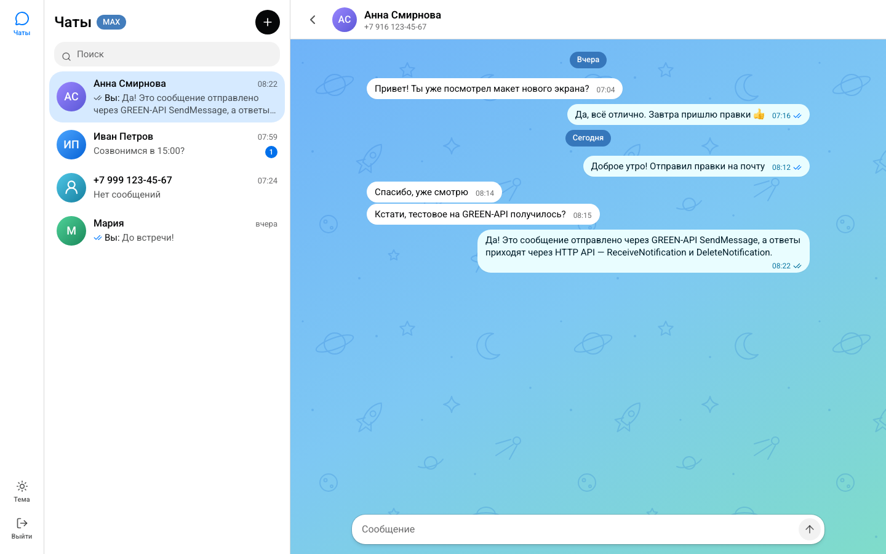
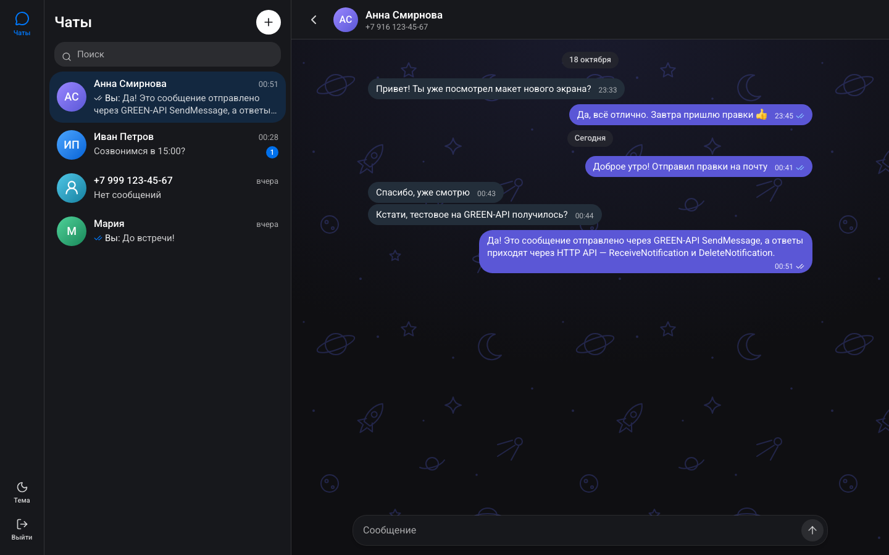
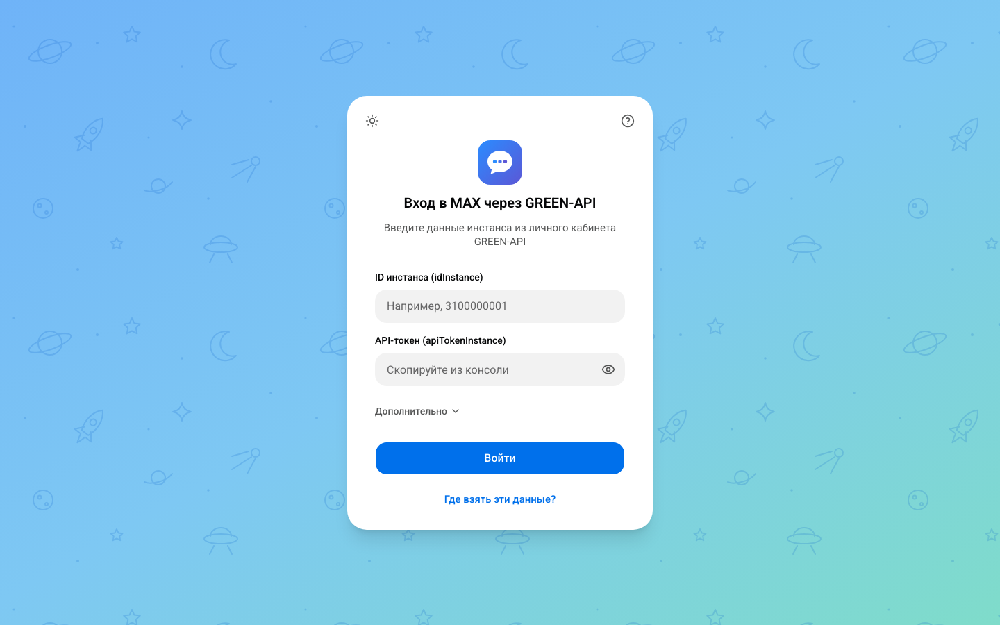
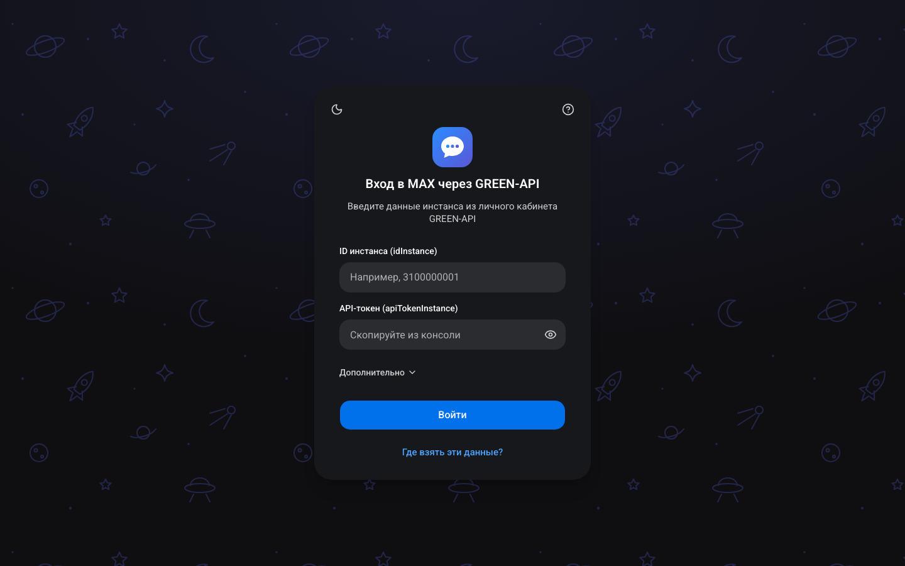
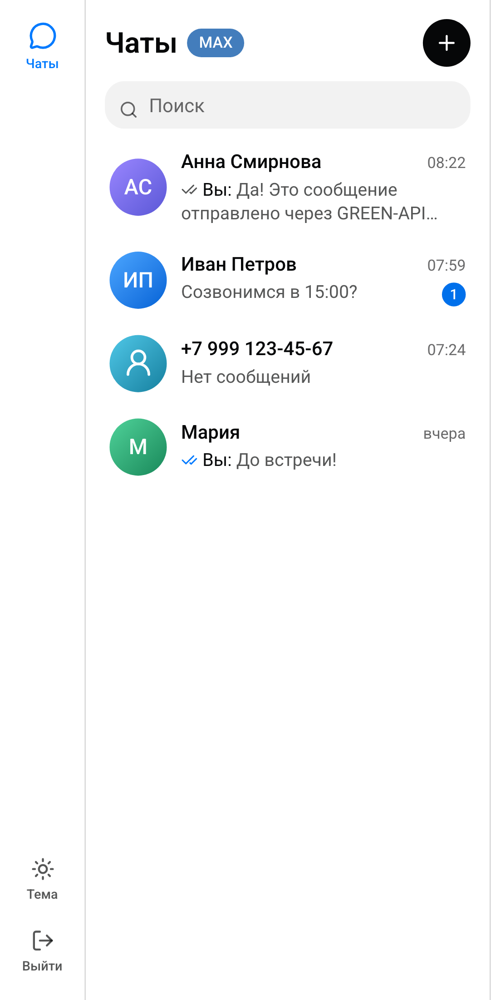
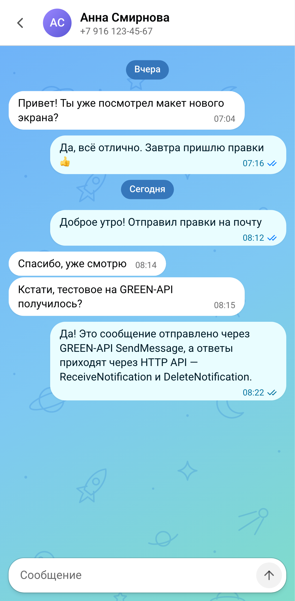
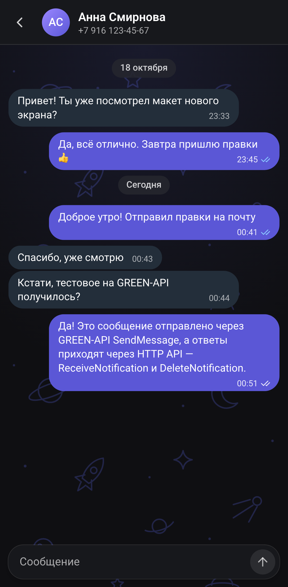

# MAX Chat — веб-чат для MAX через GREEN-API

Тестовое задание на должность «Фронтенд разработчик React» в [GREEN-API](https://green-api.com/max): интерфейс для отправки и получения текстовых сообщений в мессенджере MAX. За образец внешнего вида взят [web.max.ru](https://web.max.ru/).

**Демо:** https://green-api-max-chat-mu.vercel.app  
**Видео:** [docs/demo.mp4](docs/demo.mp4) · [скриншоты](#скриншоты) · [запуск локально](#запуск-локально)


## Как это работает

Сценарий из задания:

1. **Вход.** Пользователь вводит `idInstance` и `apiTokenInstance` из консоли GREEN-API. Адрес API (`https://3100.api.green-api.com` и т. п.) определяется по `idInstance`, при необходимости его можно указать вручную. Приложение проверяет данные (`getStateInstance`) и настройки инстанса (`getSettings`).
2. **Новый чат.** Пользователь вводит номер телефона в любом привычном виде (`8 999 …`, `+7 (999) …`). Номер проверяется методом `CheckAccount`, который возвращает `chatId` получателя в MAX.
3. **Отправка.** Сообщение уходит методом [`SendMessage`](https://green-api.com/v3/docs/api/sending/SendMessage/) и сразу появляется в чате; дальше видны статусы: отправлено → доставлено → прочитано.
4. **Получение.** Ответы приходят по технологии [HTTP API](https://green-api.com/v3/docs/api/receiving/technology-http-api/): `ReceiveNotification` + `DeleteNotification`.
5. **Ответ в чате.** Получатель отвечает в MAX — сообщение появляется в переписке, чат получает имя собеседника из MAX.

## Скриншоты

| Светлая тема                                                    | Тёмная тема                                                   |
| --------------------------------------------------------------- | ------------------------------------------------------------- |
|    |    |
|  |  |

| Мобильная версия                                         |                                                      |                                                                  |
| -------------------------------------------------------- | ---------------------------------------------------- | ---------------------------------------------------------------- |
|  |  |  |

## Возможности

- Вход по `idInstance` и `apiTokenInstance` с понятными ошибками на русском (неверный токен, инстанс не найден, нет сети…).
- Проверка инстанса: если он не авторизован в MAX или выключены нужные уведомления, приложение показывает баннер и **включает настройки одной кнопкой** (`SetSettings`).
- Создание чата по номеру телефона, поиск по чатам, счётчик непрочитанных.
- Отправка текста (до 4000 символов): сообщение появляется сразу, при ошибке — причина и кнопка «Повторить».
- Получение входящих сообщений, сообщений, отправленных с телефона, и статусов доставки и прочтения.
- Светлая и тёмная тема, адаптивная вёрстка (на телефоне список и переписка открываются по очереди, как в мобильном MAX).
- История сохраняется в браузере и переживает перезагрузку страницы; кнопка «Выйти» удаляет её с устройства.

## Подготовка инстанса GREEN-API

1. Зарегистрируйтесь в [консоли GREEN-API](https://console.green-api.com) и создайте инстанс MAX (бесплатный тариф «MAX Developer» подходит).
2. Привяжите аккаунт MAX: в приложении MAX откройте «Профиль → Устройства → Войти по QR-коду» и отсканируйте QR-код из консоли.
3. Скопируйте `idInstance` и `apiTokenInstance` и войдите в чат.
4. На новом инстансе уведомления выключены. После входа приложение покажет баннер «Сообщения не будут приходить» — нажмите «Исправить настройки» (инстанс перезапустится, это занимает до 5 минут). Для приёма через HTTP API поле `webhookUrl` должно быть пустым.

Ограничения бесплатного тарифа: переписка не больше чем с 3 чатами в месяц и 100 проверок номеров (`CheckAccount`).

## Запуск локально

Нужен Node.js 22.12 или новее (само приложение собирается и на Node 20.9+, новее нужен для тестов).

```bash
git clone https://github.com/Bolatbekermekov/green-api-max-chat.git
cd green-api-max-chat
npm ci
npm run dev
```

Откройте http://localhost:3000. Переменные окружения не нужны.

Продакшен-сборка: `npm run build && npm start`.

## Тесты и проверки

```bash
npm test               # юнит- и компонентные тесты (Vitest + Testing Library)
npm run e2e            # end-to-end в Playwright: десктоп и мобильный (Pixel 7)
npm run lint           # ESLint
npm run typecheck      # TypeScript
```

Перед первым запуском e2e установите браузер: `npx playwright install chromium`.

Тесты не обращаются к настоящему GREEN-API. Юнит-тесты используют подменённый `fetch`, e2e — заглушку API в браузере (`e2e/mock-green-api.ts`) с тем же поведением очереди уведомлений. Форматы ответов и уведомлений взяты из документации GREEN-API для MAX (`src/lib/green-api/fixtures.ts`).

`npm run e2e:capture` заново снимает скриншоты и демо-видео для этого README.

## Архитектура

|           |                                                 |
| --------- | ----------------------------------------------- |
| Фреймворк | Next.js 16 (App Router), React 19, TypeScript   |
| Стили     | Tailwind CSS 4, shadcn/ui (Radix), lucide-react |
| Состояние | Zustand (с сохранением в `localStorage`)        |
| Валидация | Zod — формы и уведомления GREEN-API             |
| Тесты     | Vitest, Testing Library, Playwright             |
| Деплой    | Vercel                                          |

```
src/
  app/                    layout, страница, дизайн-токены (globals.css)
  components/             общие компоненты: провайдер клиента, тема, аватар, фон чата
  features/
    auth/                 экран входа, проверка данных и настроек инстанса
    chats/                список чатов, поиск, диалог «Новый чат» (CheckAccount)
    conversation/         переписка, поле ввода, отправка со статусами
    messenger/            раскладка, опрос уведомлений, баннеры состояния
  lib/
    green-api/            клиент API, ошибки, разбор уведомлений, цикл опроса
    phone.ts, format.ts   номера телефонов и даты по-русски
  store/                  чаты и сессия (Zustand)
e2e/                      Playwright и заглушка GREEN-API
```

**Next.js без собственного сервера.** GREEN-API разрешает запросы из браузера (CORS `*`), поэтому приложение обращается к API напрямую: токен пользователя не проходит через чужой сервер, а серверные функции и прокси не нужны. Next.js даёт структуру приложения, оптимизацию шрифта и простой деплой; вся логика чата — клиентская.

**Получение сообщений** (`src/lib/green-api/poll-loop.ts`):

- один запрос `ReceiveNotification` за раз с `receiveTimeout=20`;
- каждое полученное уведомление обрабатывается и **удаляется в `finally`**, даже если оно не про чат: иначе очередь GREEN-API не отдаст следующее;
- доставка «хотя бы один раз»: если удаление не удалось, уведомление придёт снова, а хранилище чатов игнорирует повтор (ключ — `chatId` + `idMessage`);
- при ошибках сети и сервера — повтор с паузой 1 → 2 → 4 … 30 с и баннер «Переподключаемся»; при неверных данных (401/403/404) — выход;
- запрос отменяется через `AbortController` при выходе и размонтировании;
- опрашивает только одна вкладка (Web Locks API), остальные синхронизируются через `localStorage`.

**Чат по номеру телефона.** В MAX у получателя числовой `chatId`, поэтому номер сначала проверяется через `CheckAccount`. Формат `номер@c.us` из WhatsApp здесь не подходит: ответы на такие сообщения приходят с числовым `chatId`, а бесплатный тариф посчитал бы это как два разных чата. Найденный `chatId` запоминается, чтобы не тратить лимит проверок.

**Свои сообщения и эхо.** Сообщение показывается сразу со статусом «отправляется» и обновляется по ответу `SendMessage`. Эхо из `outgoingAPIMessageReceived` не создаёт дубль, даже если пришло раньше ответа на запрос.

## Дизайн

- Цвета, шрифт (Roboto) и скругления взяты из CSS-переменных web.max.ru (тема «space»): синий акцент, цвета «пузырей», светлая и тёмная тема. Раскладка повторяет веб-версию MAX: узкая панель разделов, список чатов, переписка на фоне с узором, плавающее поле ввода.
- Компоненты переписки — из shadcn/ui (`MessageScroller`, `Message`, `Bubble`, `Marker`), перекрашенные под MAX. При проектировании использовались правила UX из ui-ux-pro-max: видимые подписи полей, ошибки рядом с полем, состояния загрузки и пустых экранов, доступность с клавиатуры.
- Несколько цветов чуть отличаются от MAX ради контраста по WCAG AA (4.5:1): кнопки `#0070eb` вместо `#007aff`, вторичный текст и время в «пузырях» темнее, свой «пузырь» в тёмной теме `#5b57d6` вместо `#6965e5`.
- Логотип и узор фона нарисованы для проекта и не копируют фирменные элементы MAX.

## Ограничения

- Только текстовые сообщения и личные чаты: сообщения других типов показываются заглушкой, группы не отображаются.
- `CheckAccount` принимает номера России (+7) и Беларуси (+375).
- История — это то, что пришло, пока приложение открыто (или лежало в очереди уведомлений, она хранится 24 часа); старая переписка с сервера не подгружается.
- Время своих сообщений берётся из часов устройства, входящих — с сервера GREEN-API.
- `idInstance` и `apiTokenInstance` хранятся в `localStorage` этого браузера и отправляются только в GREEN-API; «Выйти» удаляет их вместе с историей.
